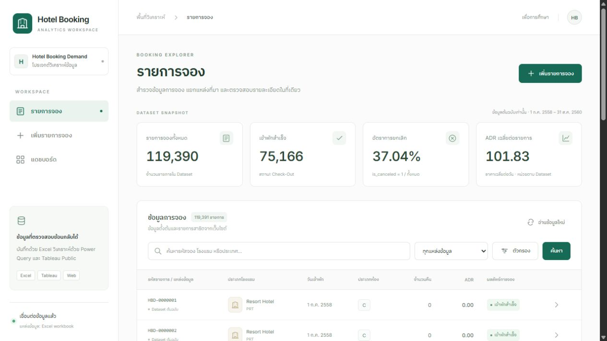
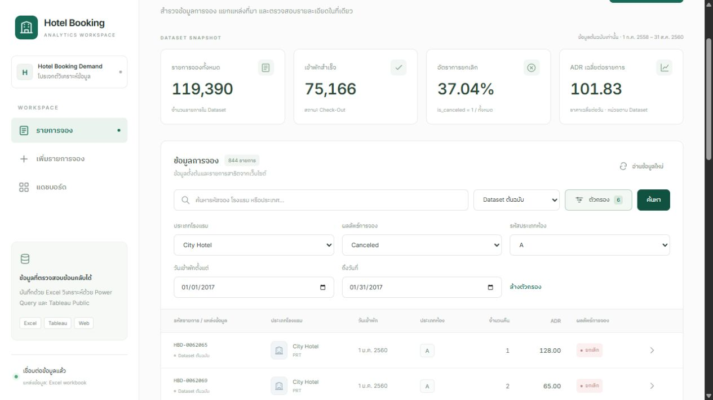
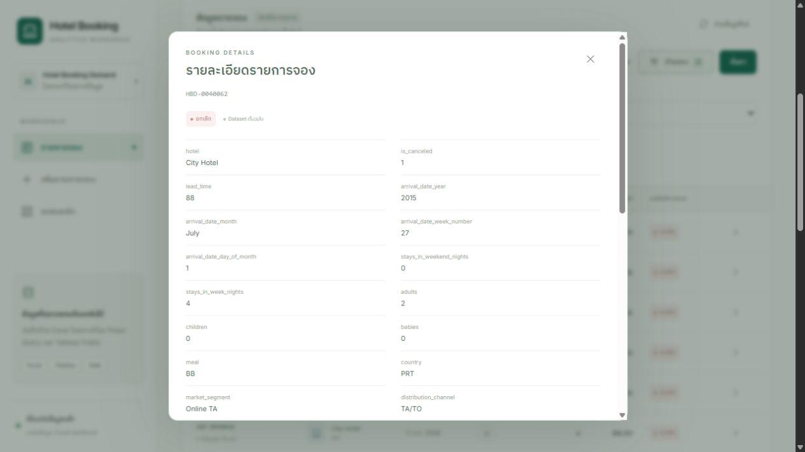
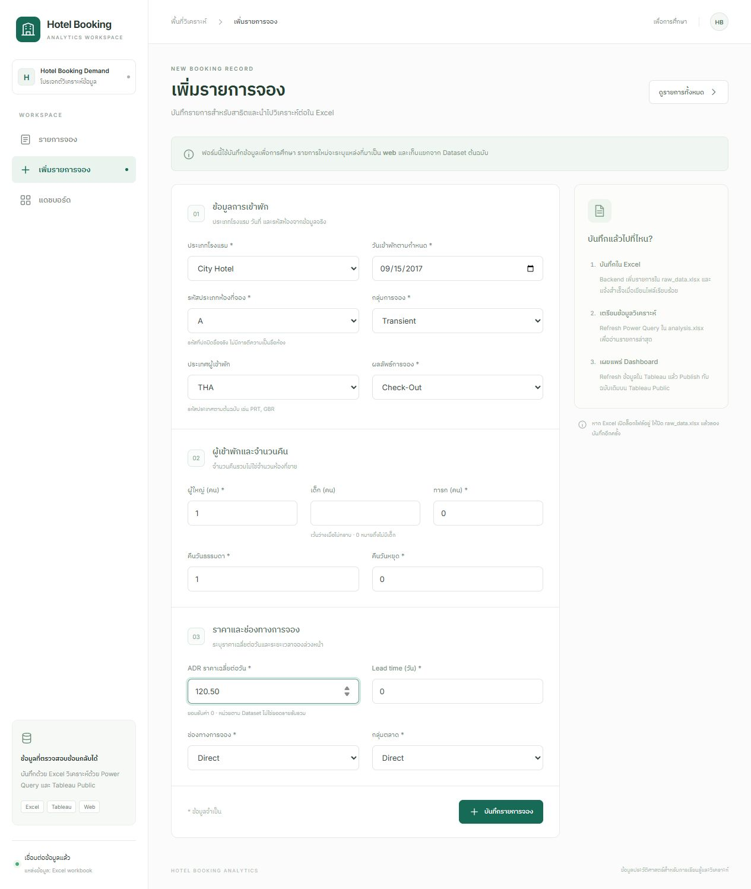
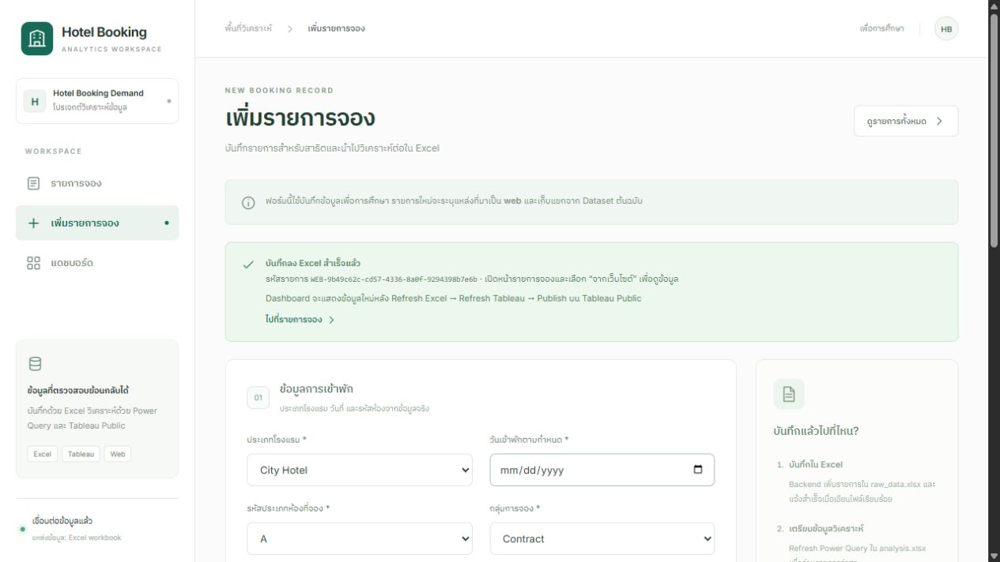
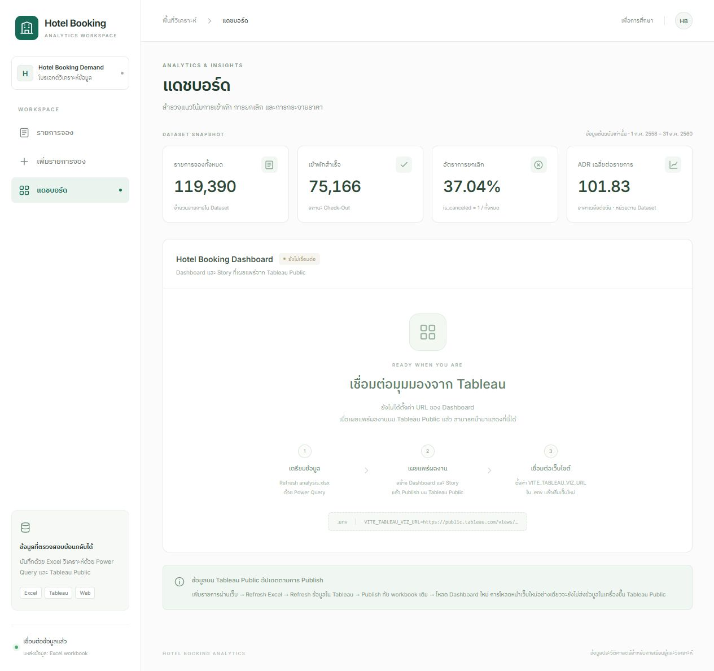
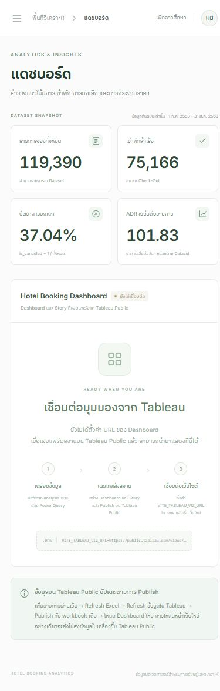
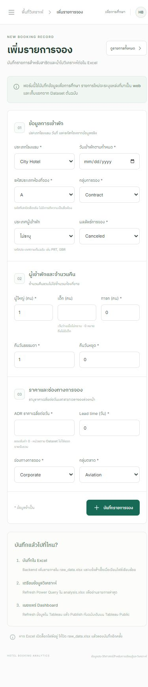
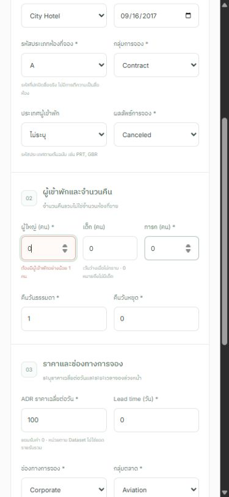
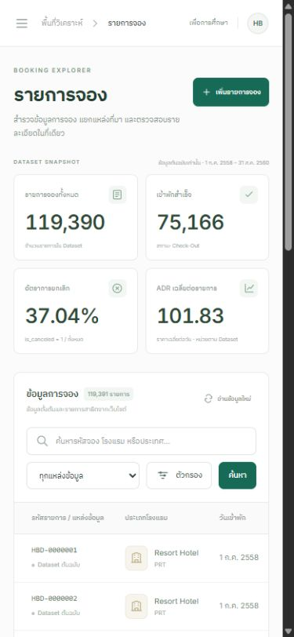

# คู่มือผู้ใช้ Hotel Booking Analytics

ระบบนี้ใช้บันทึกและวิเคราะห์ข้อมูลเพื่อการศึกษา ใช้ Dataset ประวัติศาสตร์ Hotel Booking Demand ไม่รับจองห้องพักจริง ไม่ตรวจห้องว่าง และไม่มีการชำระเงิน

ภาพในคู่มือนี้จับจากเว็บที่รันจริงบนเครื่องเมื่อ 29 ตุลาคม 2026 ข้อมูลต้นฉบับมี 119,390 รายการ และมีรายการสาธิตจากเว็บ 1 รายการ ภาพที่มีรหัส WEB เป็นข้อมูลสาธิตของระบบ ไม่ใช่รายการจริงจากโรงแรม

## 1. เริ่มใช้งาน

ติดตั้ง Node.js 22.12 ขึ้นไป แล้วเปิด Terminal ในโฟลเดอร์โปรเจกต์ รันคำสั่งเดียว:

```powershell
.\start.cmd
```

สคริปต์จะติดตั้งแพ็กเกจที่ขาด เตรียม `.env`/ข้อมูล build และเปิด [เว็บไซต์ในเครื่อง](http://127.0.0.1:3001/) อัตโนมัติเมื่ออ่านข้อมูลพร้อมแล้ว หากตั้ง `PORT` ใน `.env` จะเริ่มจากพอร์ตนั้น และถ้าพอร์ตถูกใช้จะเลือกพอร์ตว่างถัดไปให้ ดู URL หลังคำว่า `Ready:` หรือดับเบิลคลิก `start.cmd` ได้เลย เปิดหน้าต่าง Terminal ค้างไว้ระหว่างใช้เว็บ กด **Ctrl+C** เพื่อหยุด ครั้งต่อไปใช้คำสั่งเดิม โดยคงข้อมูลและการตั้งค่าเดิมไว้ รายละเอียดและโหมดพัฒนาอยู่ใน [README](README.md)

เมนูหลักมี 3 หน้า: รายการจอง, เพิ่มรายการจอง และแดชบอร์ด บนมือถือกดสัญลักษณ์เมนูมุมซ้ายบนเพื่อเปิดเมนู

## 2. หน้ารายการจอง



*ภาพที่ 1: หน้าจอจริงหลังอ่าน Excel ครบ ตัวเลขสรุปอ้างอิงข้อมูล original 119,390 รายการ ส่วนจำนวนในตาราง 119,391 รวมรายการสาธิตจากเว็บ 1 รายการ*

ตัวเลขสรุปด้านบนใช้ข้อมูล **original เท่านั้น** เสมอ พร้อมแสดงช่วงวันเข้าพัก ไม่เปลี่ยนตามตัวกรองในตาราง ได้แก่ จำนวนรายการจอง, จำนวนสถานะ Check-Out, อัตรา `is_canceled = 1` และ ADR เฉลี่ยต่อรายการ หน่วย ADR แสดงตาม Dataset โดยไม่แปลงสกุลเงิน

ค้นหาและกรองรายการ:

1. พิมพ์รหัสรายการ โรงแรม หรือประเทศในช่องค้นหา
2. เลือกแหล่งข้อมูล: ทุกแหล่งข้อมูล / Dataset ต้นฉบับ / จากเว็บไซต์
3. กด “ตัวกรอง” เพื่อเลือกโรงแรม ผลลัพธ์การจอง รหัสห้อง และช่วงวันเข้าพัก
4. กด “ค้นหา” เพื่อใช้เงื่อนไข การเลือกวันตั้งแต่และถึงเป็นขอบเขตแบบรวมวันที่นั้น
5. กด “ล้างตัวกรอง” เพื่อกลับไปแสดงทั้งหมด หรือ “อ่านข้อมูลใหม่” เพื่ออ่านรายการล่าสุดผ่าน API



*ภาพที่ 2: ตัวกรอง original, City Hotel, Canceled, ห้อง A และวันเข้าพัก 1–31 มกราคม 2017 ให้ผล 844 รายการจากข้อมูลจริง*

ตารางแบ่งหน้าฝั่ง Backend ครั้งละ 20 รายการ ใช้ “ก่อนหน้า” และ “ถัดไป” ด้านล่างตาราง กดรหัสรายการหรือลูกศรท้ายแถวเพื่อดูข้อมูลครบทุกคอลัมน์ ไม่มีการแก้ไขหรือลบข้อมูลต้นฉบับผ่านเว็บ



*ภาพที่ 3: หน้าต่างรายละเอียดของ HBD-0040062 แสดงค่าจาก Dataset ต้นฉบับ รวมแหล่งที่มาและค่าที่ไม่มีข้อมูล*

รหัส HBD มาจากลำดับแถวต้นฉบับ รหัส WEB ใช้ UUID ทั้งคู่เป็น **รหัสรายการที่ระบบสร้าง** ไม่ใช่รหัสลูกค้า ไม่ควรใช้สรุปการซื้อซ้ำรายบุคคล

## 3. หน้าเพิ่มรายการจอง



*ภาพที่ 4: ฟอร์มจริงก่อนบันทึกรายการสาธิต ใช้ค่าหมวดหมู่ที่อ่านจาก Dataset และไม่ตีความรหัสห้อง A เป็นชื่อห้องจริง*

กรอกข้อมูล 3 กลุ่ม:

1. **ข้อมูลการเข้าพัก:** ประเภทโรงแรม วันเข้าพักตามกำหนด รหัสประเภทห้อง กลุ่มการจอง ประเทศ และผลลัพธ์
2. **ผู้เข้าพักและจำนวนคืน:** จำนวนผู้ใหญ่ เด็ก ทารก คืนวันธรรมดา และคืนวันหยุด
3. **ราคาและช่องทาง:** ADR, lead time, ช่องทางการจอง และกลุ่มตลาด

ข้อควรเข้าใจระหว่างกรอก:

- เครื่องหมาย * คือข้อมูลจำเป็น ประเทศเลือก “ไม่ระบุ” ได้
- เด็กที่เว้นว่างหมายถึงไม่ทราบ (`null`) ส่วน 0 หมายถึงไม่มีเด็ก ไม่แปลงสองกรณีนี้เป็นค่าเดียวกัน
- จำนวนคน จำนวนคืน และ lead time เป็นจำนวนเต็มตั้งแต่ 0 และต้องมีผู้เข้าพักอย่างน้อย 1 คน
- ADR ยอมรับค่า 0 แต่ไม่ยอมรับค่าติดลบ ใช้หน่วยตาม Dataset ไม่ใช่รายรับรวม
- ผลลัพธ์ Check-Out ทำให้ `is_canceled = 0` ส่วน Canceled และ No-Show ทำให้ `is_canceled = 1` สำหรับรายการ web สอดคล้องกับกฎที่ใช้กับข้อมูลต้นฉบับ
- วันที่ในปฏิทินขึ้นกับภาษาเบราว์เซอร์ ข้อมูล API เก็บรูปแบบ `YYYY-MM-DD` และวันที่แสดงในตารางภาษาไทยเป็นปี พ.ศ.
- คอลัมน์ต้นฉบับที่ไม่ได้ให้กรอกจะเป็นค่าว่างตาม [DATA_DICTIONARY](DATA_DICTIONARY.md) ไม่มีการแต่งประวัติผู้เข้าพัก

กด “บันทึกรายการจอง” เพียงครั้งเดียว ปุ่มและฟอร์มจะถูกปิดชั่วคราวระหว่างเขียนไฟล์ ระบบแสดงสำเร็จหลัง Backend บันทึก `raw_data.xlsx` จริงแล้วเท่านั้น



*ภาพที่ 5: ผลการกดบันทึกผ่านหน้าเว็บจริง ระบบเขียนรายการ WEB-9b49c62c-cd57-4336-8a0f-9294398b7e6b สำเร็จ และแจ้งขั้นตอน Refresh/Publish ก่อนข้อมูลจะปรากฏใน Tableau*

หลังบันทึก กด “ไปที่รายการจอง” เลือกแหล่ง “จากเว็บไซต์” แล้วกด “ค้นหา” รายการจะยังอยู่หลังโหลดหน้าใหม่และหลัง Backend อ่านไฟล์ใหม่ รายการสาธิตที่ใช้ตรวจหน้าเว็บคือ City Hotel, วันเข้าพัก 15 กันยายน 2017, ห้อง A, ประเทศ THA, Check-Out, ADR 120.50, จำนวนคืน 1 และ children ไม่ระบุ จึงต้องกรอง original สำหรับผลรายงานจาก Dataset

หากข้อมูลไม่ถูกต้อง ระบบจะแสดงเหตุผลใต้ช่องกรอก หาก Excel ล็อก `raw_data.xlsx` ให้ปิดเฉพาะ workbook นั้นแล้วลองบันทึกใหม่ หากเกิดข้อผิดพลาดห้ามถือว่ารายการถูกบันทึกจนกว่าจะเห็นข้อความสำเร็จ

## 4. หน้าแดชบอร์ด



*ภาพที่ 6: สถานะจริงเมื่อ `VITE_TABLEAU_VIZ_URL` ยังว่าง ตัวเลขสรุปมาจาก API ส่วนพื้นที่ Tableau แสดงขั้นตอนเชื่อมต่อและไม่มีกราฟสมมติ*

ก่อนมี Dashboard ที่ Publish แล้ว หน้านี้จะแสดง “ยังไม่เชื่อมต่อ” และวิธีเตรียมข้อมูล เมื่อสร้างและ Publish งานบน Tableau Public แล้ว:

1. ใน Tableau Public ใช้เมนู Share เพื่อคัดลอกลิงก์มุมมองที่ Publish แล้ว
2. ใส่ลิงก์ในไฟล์ `.env` ที่โฟลเดอร์โปรเจกต์ เช่น:

   ```dotenv
   VITE_TABLEAU_VIZ_URL=https://public.tableau.com/views/ชื่อWorkbook/ชื่อView
   ```

3. เริ่ม Vite ใหม่ หากใช้ production ให้ build ใหม่
4. หน้าแดชบอร์ดจะโหลดด้วย Tableau Embedding API v3 มีสถานะกำลังโหลดและข้อผิดพลาด พร้อมลิงก์เปิดมุมมองต้นทาง

ใช้ HTTPS ของ `public.tableau.com` รูปแบบ `/views/...` หรือ `/shared/...` หากพบปัญหา ให้ตรวจว่าลิงก์เปิดได้จาก Tableau Public โดยตรง

เมื่อเพิ่มข้อมูลใหม่ ต้องอัปเดตตามลำดับ:

```text
เว็บไซต์บันทึก raw_data.xlsx
  → Refresh analysis.xlsx ด้วย Power Query และบันทึก
  → Refresh ข้อมูล/Extract ใน Tableau
  → Publish ทับ workbook เดิมบน Tableau Public
  → โหลด Dashboard บนเว็บไซต์ใหม่
```

ปุ่ม “โหลดฉบับที่ Publish แล้ว” โหลดงานที่อยู่บน Tableau Public เท่านั้น การ reload หน้าเว็บไม่ทำให้ข้อมูล Excel ในเครื่องถูก Publish อัตโนมัติ งานนี้ยังไม่ได้ใส่ URL สาธารณะ จึงยังไม่ได้ตรวจการแสดง Dashboard ที่ Publish จริงผ่านหน้าเว็บ

## 5. การใช้งานบนมือถือ



*ภาพที่ 7: หน้าแดชบอร์ดจริงที่ความกว้าง viewport 390 พิกเซล เมนูหลักยุบเป็นปุ่มมุมซ้ายบน*



*ภาพที่ 8: ฟอร์มเพิ่มรายการจองปรับขนาดตามจอมือถือ แสดงตัวเลือกจาก Dataset เช่นเดียวกับคอมพิวเตอร์*



*ภาพที่ 9: ทดสอบผู้ใหญ่ เด็ก และทารกรวมกันเป็น 0 ระบบปฏิเสธก่อนส่งคำขอบันทึกและแสดง “ต้องมีผู้เข้าพักอย่างน้อย 1 คน”*



*ภาพที่ 10: ตารางจริงบนมือถือ เลื่อนตารางในแนวนอนเพื่อดูคอลัมน์ด้านขวา โดยหน้าเว็บไม่ล้นความกว้างจอ*

## 6. แก้ปัญหาเบื้องต้น

| อาการ | วิธีดำเนินการ |
|---|---|
| เชื่อมต่อเซิร์ฟเวอร์ไม่ได้ | ตรวจ Terminal ของ `npm run dev` และ `/api/health` |
| ยังไม่มี Dataset หรือ raw workbook | วาง CSV ตาม README แล้วรัน `npm run import:data` |
| ไม่พบรายการ | ตรวจแหล่งข้อมูล ช่วงวันที่ และตัวกรอง หรือล้างตัวกรอง |
| บันทึกไม่ได้เพราะไฟล์ล็อก | ปิด `raw_data.xlsx` ใน Excel แล้วลองใหม่ |
| รายการเว็บไม่ปรากฏใน Tableau | Refresh Excel และ Tableau แล้ว Publish ใหม่ รวมทั้งเลือก filter ที่รวม web |
| Dashboard ยังไม่เชื่อมต่อ | ตั้ง `VITE_TABLEAU_VIZ_URL` ด้วยลิงก์ที่ Publish แล้ว และเริ่มเว็บใหม่ |
| ตัวเลขตารางไม่เท่ากับ KPI ด้านบน | KPI ใช้ original เสมอ ตารางใช้เงื่อนไขที่เลือก จึงต้องเทียบขอบเขตเดียวกัน |

ขั้นตอนติดตั้ง การทำงาน Excel และข้อจำกัดที่ยังต้องตรวจในโปรแกรมจริงอยู่ใน [README](README.md) และ [CHECKLIST](CHECKLIST.md)
